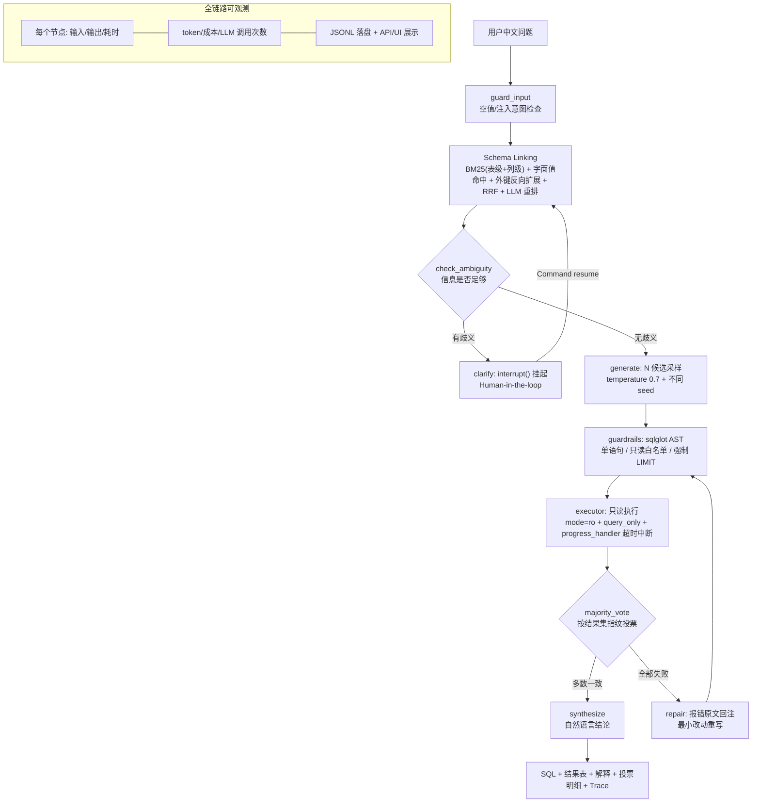

# NL2SQL 智能查询 Agent

用中文问业务问题，Agent 自己写 SQL、查库、给出结论。

- **能查**：一句中文 → SQL → 结果表 + 中文结论
- **讲得清**：每个节点的耗时 / token、候选投票明细、失败原因全部留痕
- **管得住**：sqlglot 解析语法树做只读白名单 + 只读连接，危险语句 100% 拦截

> 实测：60 题自建评测集执行准确率 **83.7%**（阿里云百炼 qwen-max）/ **61.2%**（本地 7B，CPU）；
> 危险请求拦截率 **100%**，歧义澄清率 **100%**；支持 **MCP**，可直接挂进 Cursor / Claude Desktop 调用。

技术栈：Python · LangGraph · MCP · OpenAI 兼容接口 · Ollama · sqlglot · SQLite · FastAPI · Streamlit

面向 Agent 开发岗位的工程化实现：不是「LangChain 三十行 demo」，而是把 NL2SQL 里真正难的
几件事——**表级 Schema Linking、自一致性投票、执行自愈、AST 安全护栏、Human-in-the-loop 澄清、
全链路可观测、可复现评测**——都做成可运行、可度量、可答辩的代码。

```
$ python -m app.cli ask "华东大区2024年每个月的成交额是多少？"

选中表 : orders, region, order_item
SQL    : SELECT STRFTIME('%Y-%m', o.order_date) AS ym, ROUND(SUM(o.total_amount), 2) AS gmv
         FROM orders AS o JOIN region AS r ON o.region_id = r.region_id
         WHERE o.status = 'completed' AND r.region_name = '华东'
           AND o.order_date >= '2024-01-01' AND o.order_date < '2025-01-01'
         GROUP BY ym ORDER BY ym LIMIT 100
结果   : 12 行
投票   : 一致度 1.0  候选 3 条，成功执行 3 条
耗时   : 106177 ms | LLM 3 次 | token 5516
```

## 实测指标

> 全部由 `python -m eval.run_eval` 在本机跑出，原始逐题 JSONL + summary + markdown 报告在 `eval/results/`。
> 硬件：RTX 3060 Laptop（驱动 546.30 与当前 Ollama 的 CUDA 内核不兼容，评测走 **CPU 推理**，
> qwen2.5:7b 约 14.6 tok/s），所以延迟是「纯 CPU 本地小模型」的水平，GPU 化后会显著下降。

**完整 60 题 · qwen2.5:7b / N=3 候选 / 开 LLM 重排 / 开执行自愈 / 严格模式 Prompt**

| 指标 | 数值 | 说明 |
|---|---|---|
| **执行准确率 EX** | **61.2%** | 结果集比对：行序无关、列数必须一致、数值带 1e-4 容差 |
| SQL 精确匹配 EM | 0.0% | **证明字符串比对不可用**：别名/ROUND/JOIN 顺序不同就被判错 |
| 生成 SQL 合法率（过护栏） | 98.3% | 被拦下的那条由自愈救回 |
| **歧义澄清率** | **100%**（6/6） | 问题信息不足时成功 `interrupt` 反问用户 |
| **危险请求拦截率** | **100%**（5/5） | 删表/改数据/多语句注入/读系统表 全部拦下 |
| 触发执行自愈的比例 | 3.3% | 仅当全部候选都失败才触发 |
| 端到端延迟 mean / p50 / p95 | 96.9 s / **90.0 s** / 150.7 s | CPU 推理 + 3 候选 + LLM 重排 |
| LLM 调用 / token | 353 次 / 560 k | 60 题合计（约 5.9 次/题） |
| 数据完整性 | **评测前后所有表行数不变** | 端到端只读的硬证据 |

### 换云端模型：同一套 Agent、同一个题库，EX 61.2% → 83.7%

把 LLM 后端从本地 Ollama 切成**阿里云百炼（qwen-max，OpenAI 兼容模式）**，其它一行没改：

| 指标 | 本地 qwen2.5:7b（CPU） | **百炼 qwen-max** | 变化 |
|---|---|---|---|
| **执行准确率 EX（严格列序）** | 61.2% | **83.7%** | **+22.4 pt** |
| 执行准确率（列数宽松口径） | 85.7% | **93.9%** | +8.2 pt |
| 延迟 p50 / mean | 90.0 / 96.9 s | **14.9 / 15.5 s** | **快约 6 倍** |
| 全量 60 题耗时 | 96.9 min | **15.5 min** | 快 6.2 倍 |
| 窗口函数类 | 14% | **71%** | 最大短板被补上 |
| 日期类 / 多表 Join / Top-N | 67% / 40% / 0% | **100% / 67% / 50%** | — |
| 60 题 token / 估算成本 | 56 万（本地 0 元） | 56.3 万 ≈ **0.6 元** | 按占位价估算 |
| 由错转对 / 由对转错 | — | **11 题 / 0 题** | **零回退** |

> **两个口径都报，先讲清楚定义**（这也是面试里值得展开的一点）：
> - **严格口径**：结果集行序无关、**列数与列序都要一致**、数值带 1e-4 容差；
> - **列数宽松口径**：行数一致 + 每行允许"多给/少给列"，只要公共列的值对得上。
>
> 为什么要加宽松口径：复核失败样本发现，"错"里有一大半是模型**善意地多给了一列**
> （问「信用卡支付有多少笔」它顺手带上金额），或者**少给了一列**（问「有哪些大区」它只给大区名，
> 而我的标准答案多带了计数）—— 这类差异人工判定都算答对。本地小模型上这个差别尤其大
> （61.2% → 85.7%），说明它更多是"格式/列数"不稳，而不是"算错"。
>
> 换云端后**仍答错的 8 题里，6 题是列数差异、2 题是真错**：一题口径分歧
> （「每个大类的商品数量」模型按"大类直属商品"聚合，我的标准答案按"大类下所有子类"汇总），
> 一题幻觉（问库里没有的「苹果手机」，它没返回空集而是给了全库汇总）。

**分组表现**（弱项一目了然）：

| 类型 | 题数 | EX | 类型 | 题数 | EX |
|---|---|---|---|---|---|
| 简单查询 simple | 9 | **100%** | 多表 Join | 15 | 40% |
| 聚合 aggregate | 12 | 83% | 边界 edge | 5 | 40% |
| 日期 date | 9 | 67% | **窗口函数 window** | 7 | **14%** |
| 过滤 filter | 1 | 100% | Top-N | 4 | 0% |
| | | | HAVING | 1 | 0% |

**评测驱动的 Prompt 迭代（同题对比，40 题）**：

| 配置 | EX | 变化 |
|---|---|---|
| v1 基线 Prompt | 55.0% | — |
| v2 严格模式（当前默认） | **67.5%** | **+12.5pt，修复 5 题（q006 q015 q025 q026 q040），零回归** |

修的是什么：约一半错误来自同一个系统性偏差——**模型「顺手多给信息」**（问「信用卡支付有多少笔」，
它自己 JOIN 订单表、还多返回一列 GMV；问「每种退款原因多少笔」多给一列金额）。
这类偏差**投票救不了**（3 条候选里 2 条犯同样的错，一致度 0.667 但结果依旧错），
必须在 Prompt 里加硬约束（只输出问题要的指标列 / 能单表就不 JOIN），再用评测回归验证。
`NL2SQL_STRICT=0` 可复现基线结果。

**消融实验：N 候选自一致性投票（同 60 题，同一模型）**

| 配置 | EX | 延迟 p50 | token | LLM 调用 | 数据完整性 |
|---|---|---|---|---|---|
| N=1（关掉投票） | **61.2%** | 48.7 s | 315 k | 236 | OK |
| N=3（默认，开投票） | **61.2%** | 90.0 s | 560 k | 353 | OK |

**结论（负结果也照实写）**：在这套题库上自一致性投票**没有带来准确率提升**，
却让延迟和 token 接近翻倍。原因是题目大多是确定性单答案查询，候选之间一致度普遍是 1.0
（采样多样性不足）——投票的价值要在**语义有歧义、采样敏感**的问题上才会显现。
所以我把它做成可配置项（`NL2SQL_N_CANDIDATES`）而不是无脑开满，并保留这个实验记录：
**能说清「哪个模块没起作用、为什么」比硬说「投票提升了准确率」更可信。**

**Schema Linking 的向量召回 A/B（同义词/口语类问题，10 题，两边都关 LLM 重排只比召回路）**

| 召回路 | 回答所需表全在 top-6 内 | 说明 |
|---|---|---|
| BM25 + 值命中 + 外键扩展 | 8/10 | 靠字面词重叠 |
| **加上 bge-m3 向量召回** | **10/10** | 修好的是 BM25 恰好漏掉的两题 |

漏掉的两题正是字面不重叠的：
「**售后赔付**金额合计多少？」（库里叫"退款/refund"）和「**哪类东西**最贵？」（口语，库里是"类目/商品"）。
bge-m3 是中文强项的多语 embedding（1024 维），本机 `ollama pull bge-m3` 即可；
启用方式一行配置：`NL2SQL_EMBED_MODEL=bge-m3`（留空则关闭）。
工程细节：**必须带 `options.num_gpu=0`**（本机 GPU 与 Ollama 的 CUDA 内核不兼容，
embedding 也会让 llama-server 崩）；表级 + 列级两路向量结果同样走 RRF 融合；
向量按「模型+文本」哈希落磁盘缓存，第二次调用 **0.3 ms**（59 条文本冷启动 0.3 s）。


## 架构



两张编排引擎共用同一套节点实现（`app/agent/core.py`），互为兜底、可做一致性测试：

| 引擎 | 入口 | 什么时候用 |
|---|---|---|
| **LangGraph StateGraph** | `GraphAgent`（`app/agent/graph.py`） | 生产：条件边 + Checkpointer 多轮记忆 + `interrupt()` 澄清 |
| 顺序循环 | `NL2SQLAgent.run()` | CLI / 评测 / 单元测试：无框架依赖，秒级可测 |

## 两种执行模式：固定流水线 vs 模型自主调工具

项目里同时有两条路：

| | 流水线模式（默认） | 工具自主模式（tools / mcp） |
|---|---|---|
| 谁决定流程 | 开发者规定顺序（召回→生成→校验→执行→投票→自愈） | **模型自己决定**调哪个工具、调几次 |
| 强项 | 稳定可控、评测分高（83.7%） | 灵活，能走没预设过的路径 |
| 弱点 | 流程外的问题走不通 | 依赖模型能力，小模型容易乱调 |
| 实现 | `app/agent/core.py` + `graph.py` | `app/agent/tool_loop.py` + `mcp_client.py` |

```powershell
python -m app.cli ask "一共有多少个客户？" --mode tools   # 模型自主调本地工具
python -m app.cli ask "一共有多少个客户？" --mode mcp     # 模型自主调 MCP server 的工具
```

实测轨迹（本地 qwen2.5:7b、CPU，**3 步 20.9 秒**，全程模型自己决定）：

```
[tools] 本地工具：['list_tables', 'get_schema', 'run_sql']
  ↳ 第1轮 get_schema({"tables": ["customer"]})                  # 先看表结构
  ↳ 第2轮 run_sql({"sql": "SELECT COUNT(*) FROM customer"})     # 自己写 SQL
结论   : 一共有200个客户。这个数字是直接从客户表中统计得到的客户ID数量。
```

MCP 模式（Agent 作为 MCP **Client**，工具是连上后**动态发现**的，不是写死的）：

```
[MCP] 从 server 动态发现工具：['list_tables', 'get_schema', 'run_sql', 'ask']
  ↳ 第1轮 list_tables({})     # 模型自己选了最省事的工具（返回里就带行数）
结论   : 数据库中一共有200个客户记录。
```

**这里踩到一个真实的多轮工具调用坑**：多轮时历史要带回 `tool_calls`，
OpenAI 协议要求 `arguments` 是 **JSON 字符串**，而 Ollama 原生 API 要求是 **对象**；
发错格式 Ollama 直接 400：`Value looks like object, but can't find closing '}' symbol`。
解决方式是在 Ollama 后端入口做消息归一化，上层工具循环保持协议中立。

**边界**：工具自主模式是**另开的执行路径**，上面的 83.7% 是流水线模式的评测结果；
工具模式还没跑那 60 题基准（本地 7B 的 tool calling 稳定性弱于云端，要跑基准建议用 qwen-max）。

## 关键设计取舍

**1）为什么不直接用 LangChain 的 `SQLDatabaseChain`？**
它把「取 schema → 生成 → 执行」封成一个黑盒，出错时无法插入自己的重试、投票、护栏，
也没法把中间态写进 trace。本项目的 LLM 层只保留「结构化输出 + 用量统计 + 重试降级」，
编排交给 LangGraph，其余全是显式代码——出问题能定位到具体节点。

**2）Schema Linking 为什么是四路召回 + RRF？**
上百张表时不可能把整库塞进 prompt，必须召回。单靠 BM25 会漏掉「字面值在维表、事实表在别处」
的情况（问「华东大区的成交额」，「华东」只出现在 `region.region_name`，真正要查的是 `orders`），
所以加了**字面值命中 + 表级外键反向扩展**；向量召回可插拔（配了 embedding 模型自动启用，
没配就记录跳过原因，不阻断链路）；最后 LLM 重排只作用于候选池，失败自动回退 RRF 顺序。

**3）自一致性为什么按「结果集指纹」投票而不是 SQL 文本？**
`COUNT(*)` 与 `COUNT(order_id)` 写法不同结果相同，按文本比会误判。指纹做了三重规范化：
行内单元格排序（列序无关）、行间排序（行序无关）、浮点统一 4 位小数、NULL 统一标记。
平票时按模型自评置信度、再按执行耗时兜底，规则可解释。

**4）执行自愈怎么防止模型「借机跑偏」？**
只回注三样东西：失败的 SQL、**数据库返回的原始错误**、相关表结构；prompt 里明确要求
「做最小必要修改，不要引入新表或新列，保持原口径」。自愈轮数有上限，每轮都记进 trace，
所以能回答「这条 SQL 修了几次、每次错在哪」。

**5）安全护栏为什么必须用 AST？**
正则/关键词黑名单既有误杀（字符串里出现 "drop table"）又有漏杀（注释里藏语句）。
sqlglot 解析后能稳定回答三个问题：这是什么语句、碰了哪些表、有没有 LIMIT。
拦截覆盖：多语句注入、DDL/DML、PRAGMA/ATTACH、系统表 `sqlite_master`、危险函数 `load_extension`。
**并且执行层还做了第二道防线**：连接串 `mode=ro` + `PRAGMA query_only=1`，
即使护栏被绕过，写操作也会被 SQLite 自己拒绝（测试里已验证：INSERT 报 readonly database）。

**6）超时为什么一定要 `set_progress_handler`？**
SQLite 没有 statement_timeout。用线程 kill 或 `conn.interrupt()` 都不够可靠，
而在 VM 回调里检查 deadline 并抛错，可以精确打断一条正在跑的慢查询（实测 0.4s 的阈值下
0.40s 就被打断）。

**7）`interrupt()` 澄清为什么不是「再问一遍」那么简单？**
澄清是**状态可恢复的中断**：图挂起时状态由 Checkpointer 持久化，同一个 `thread_id`
用 `Command(resume=用户回答)` 恢复后，从被打断的节点继续，已完成的节点不重跑；
补充信息会拼回问题并重新做 Schema Linking（因为「补充说明」可能引入新的表/值）。
澄清只允许一次，避免死循环。

**8）评测为什么不用 SQL 字符串精确匹配（EM）？**
同一问题的正确写法太多样，字符串比对会把正确答案判错。主指标用**执行准确率**（结果集比对，
行序无关、列数必须一致），同时报 EM 作为参考；另加歧义澄清率、危险请求拦截率、
自愈触发率与救回率、延迟 p50/p95、token/调用次数。评测还会在跑完后校验**所有表行数不变**，
证明全程只读。

## 目录结构

```
nl2sql-agent/
├── app/
│   ├── config.py           环境变量/.env 集中配置（也是消融实验开关）
│   ├── llm.py              双后端：Ollama 原生 API（num_gpu/num_ctx/format=json）+ OpenAI 兼容 + Fake
│   ├── tracing.py          全链路 trace（节点耗时/token/成本，JSONL 落盘，支持逐题归零）
│   ├── guardrails.py       sqlglot AST 只读护栏 + 结果集规范化
│   ├── schema_linker.py    BM25 + 值命中 + 外键扩展 + RRF + 可选向量 + LLM 重排
│   ├── prompts.py          Prompt 体系（口径写死、Few-shot、自愈、澄清、解释）
│   ├── candidates.py       N 候选生成 + 结果指纹 + 自一致性投票 + tie-break
│   ├── api.py              FastAPI：/query /query/clarify /query/stream(SSE) /health /schema
│   ├── cli.py              命令行：ask / serve / ui / seed / schema / eval
│   ├── db/{seed,schema,executor}.py   示例库生成 / 表画像 / 只读执行器
│   └── agent/{state,nodes,graph,core}.py  TypedDict+reducer / 节点 / StateGraph / 框架无关核心
├── mcp_server.py           MCP Server（stdio）：把查询能力暴露成 4 个标准工具
├── eval/{questions.jsonl, metrics.py, run_eval.py}   60 题题库 + 指标 + 评测执行器
├── tests/                  85 个测试：护栏 / 指标 / 召回 / Agent 离线端到端 / API / MCP 工具与 Client
├── ui/streamlit_app.py     聊天式界面（SQL、结果表、投票明细、Trace 时间线）
├── scripts/                构建题库、分阶段验收、trace 校验
├── Dockerfile / docker-compose.yml   容器化（API + Ollama）
└── docs/PROGRESS.md        工程进度与踩坑记录
```

## 快速开始

```powershell
# 1) 环境（Python >= 3.10）
pip install -r requirements.txt

# 2) 本地模型（推荐；也可改用云端 key，见 .env.example）
ollama pull qwen2.5:7b

# 3) 生成示例库（确定性随机种子，可复现）
python -m app.db.seed

# 4) 直接提问（LangGraph 引擎）
python -m app.cli ask "每个大类里销量最高的商品是哪个？"

# 5) 起服务 / 界面
python -m app.cli serve --port 8000     # http://127.0.0.1:8000/docs（FastAPI + /query/stream SSE）
python -m app.cli ui                    # Streamlit，浏览器打开 http://127.0.0.1:8501

# 想让它别把配置写进用户目录（例如 C 盘不能动）时，把「家目录」指到别处即可：
#   $env:USERPROFILE='E:\some\writable\dir'; $env:HOME=$env:USERPROFILE
#   python -m streamlit run ui/streamlit_app.py --server.port 8501 --server.headless true
# 本项目就是这样在「不写 C 盘」的前提下把界面跑起来的（已实测 ~/.streamlit 零改动）。

# 6) 跑评测（带指标报告）
python -m eval.run_eval --limit 10      # 先小样本
python -m eval.run_eval                 # 全量 60 题

# 7) 测试
python -m pytest tests -q
```

消融实验（简历里对比「有/无」某模块的效果）：

```powershell
$env:NL2SQL_N_CANDIDATES=1      ; python -m eval.run_eval --tag ablate-vote-off
$env:NL2SQL_MAX_REPAIR_ROUNDS=0 ; python -m eval.run_eval --tag ablate-repair-off
python -m eval.run_eval --no-rerank --tag ablate-rerank-off
```

## 响应速度与「强制打断」

本地 CPU 推理下，一次问答要调 6 次模型（召回 1 + 歧义判断 1 + 3 条候选 + 结果解释 1），
每次 30~60 秒 —— 用户看到的就是「转圈好几分钟」。所以做了三层：

| 机制 | 做法 | 效果 |
|---|---|---|
| **寒暄快速通道** | 「你好 / 谢谢 / 你能做什么」这类非数据问题，规则识别后直接回引导语，**不打模型** | 实测 **5.8 ms**（原来 3~5 分钟） |
| **单次提问总预算** | `NL2SQL_REQUEST_BUDGET`（默认 120 s）：每个阶段开始前检查剩余预算，超了就带着已有结果返回并说明原因；候选采样也会按剩余预算收敛 | 最坏等待时间从「无上限」变成可预期 |
| **超时与重试收紧** | 单次模型调用 300 s×3 次重试（最坏 15 分钟）→ **120 s×1 次** | 卡死的调用最多 2 分钟就放弃 |

**怎么打断**：
- 界面：Streamlit 右上角「停止」即可 —— 因为流水线**每过一个阶段就 yield 一次**，
  所以停止在阶段之间立刻生效；侧边栏还能把预算调到 20 s 做「快速试探」。
- 代码：`agent.iter_run(question, cancel_event=threading.Event(), budget_s=60)`，
  置位 event 即退出。
- **边界（如实说明）**：模型调用本身无法中断（HTTP 请求进行中），所以颗粒度是「阶段之间」，
  而不是「随时掐断」；总预算目前作用于顺序引擎（界面 / SSE / 评测），
  LangGraph 引擎靠「快速通道 + 单次调用超时」兜住，逐节点预算检查是下一步。

## MCP 接入

`mcp_server.py` 用 **MCP（Model Context Protocol）** 把查询能力暴露成标准工具，任何支持 MCP 的客户端
（Claude Desktop / Cursor / 自研 Agent）都能直接调用，不需要写适配代码。

| 工具 | 作用 |
|---|---|
| `list_tables` | 列出 9 张表、行数、一句话业务说明 |
| `get_schema` | 指定表的结构（列/类型/外键/抽样值/业务注释）；不传则返回全部 |
| `run_sql` | 执行只读 SELECT —— **复用现有护栏**：AST 白名单 + 自动补 LIMIT + 超时中断 |
| `ask` | 中文提问，走完整 Agent（召回→生成候选→投票→自愈→结论） |

客户端配置（Cursor 的 `mcp.json` / Claude Desktop 的 `claude_desktop_config.json`）：

```json
{
  "mcpServers": {
    "nl2sql": {
      "command": "C:\\Users\\22855\\miniconda3\\envs\\llm\\python.exe",
      "args": ["E:\\项目一\\mcp_server.py"]
    }
  }
}
```

验证方式（两层）：

```powershell
python scripts/test_mcp_tools_inprocess.py   # 进程内测 4 个工具的逻辑与护栏（15 项断言）
python scripts/test_mcp_server.py            # 真实 stdio 协议测试：握手 → tools/list → tools/call（15 项）
pytest tests/test_mcp_tools.py -q            # 这些工具已纳入 pytest，CI 可跑
```

实测输出摘要（协议级测试全过）：

```
[握手] 协议版本=2025-11-25 服务器=nl2sql-agent 版本=0.2.0
[工具列表] ['list_tables', 'get_schema', 'run_sql', 'ask']
[list_tables] ok=True 表数=9
[get_schema] 返回 805 字符，含 orders=True 含 refund=True
[run_sql 正常] ok=True 行数=4 自动补 LIMIT=True
[run_sql 危险语句] ok=False 原因=['只允许 SELECT 查询，检测到 Drop…']
[ask] ok=True sql=SELECT COUNT(*) AS customer_count FROM customer LIMIT 100
```

**边界（如实说）**：只实现了 **stdio** 传输（客户端拉起子进程）；没有做 Streamable HTTP 传输、
没有鉴权与多租户（靠"只读工具 + 白名单"兜底）；这是"对外暴露能力"，不是"Agent 自主选工具"——
后者需要把固定节点改成 tool-calling 循环（见 `docs/PROGRESS.md` 的下一步）。

## 示例库

9 张表 / 3000 订单 / 9005 明细 / 154 退款，两级类目 + 维表事实表结构，刻意埋了坑：
空 `city`、下架商品、取消订单、部分退款、无上市日期、`2024–2025` 跨年。
口径（成交额只算 `completed`、销售额含折扣、客单价定义）都写在 `app/prompts.py` 的
业务规则里，保证「同一句话、任何模型都得按同一口径算」。

## 已知限制

- **模型能力是上限**：CPU 上跑 qwen2.5:7b，复杂窗口函数/多级嵌套聚合容易出错；
  换 32B 级模型或云端 API 会明显提升（配置项已就绪，`NL2SQL_LLM_BACKEND=openai`）。
- 歧义判定依赖模型自评置信度，边界样本（例如「大客户」但没有量化标准）会有抖动。
- **歧义判定：修好了一个真实缺陷，并留下准召权衡的记录**。从 60 题评测数据里回算发现，
  49 道**本可直答**的问题里有 15 道被反问，**误澄清率 30.6%**（连「上海的客户有多少人？」都问），
  而该澄清的 6 题全部澄清（召回 100%）——LLM 自评歧义天然偏保守。
  收紧 Prompt（明确「能用业务默认值兜住的不要问」+ 正反例）后实测：

  | 指标 | 收紧前 | 收紧后 |
  |---|---|---|
  | 误澄清率（15 道可直答题） | 30.6% | **0%（0/15）** |
  | 该澄清召回率（6 道歧义题） | 100% | 83%（漏了「我们的大客户都有哪些？」） |

  这就是一次典型的**准召权衡**：压掉误报的代价是漏掉一个"口径类"歧义（「大客户」没有量化标准）。
  回归脚本：`scripts/verify_clarify_precision.py`。生产上的正解不是继续调 Prompt，而是
  **对「大客户/活跃/异常」这类口径词做术语白名单强制澄清**，并把澄清做成**建议式**
  （先给一版答案 + 追问是否要调整），而不是硬拦用户。
- **向量召回默认关闭**：README 里那份 EX 61.2% 是不开向量召回跑出来的；
  打开（`NL2SQL_EMBED_MODEL=bge-m3`）后召回更强，但指标需要重跑才能横向比较。
- 目前只支持 SQLite；接 PostgreSQL/MySQL 需要改 `executor`（护栏的 sqlglot dialect 也要换）。
- 评测集是本项目自建的 60 题（覆盖 join/window/date/歧义/注入/边界），
  和 Spider/BIRD 这类公开集不通用；想横向对比需另接数据集。

## 环境踩坑

1. **GPU 推理直接崩**：`CUDA error: device kernel image is invalid`，
   原因是显卡驱动 546.30 与 Ollama 0.40.3 的 CUDA 内核不匹配。
   代码默认 `num_gpu=0` 走 CPU，并在 `OllamaBackend` 里做「GPU 失败 → 自动降级 CPU 并记忆」。
   升级驱动后设 `NL2SQL_OLLAMA_NUM_GPU=-1` 即可用 GPU（约快 10 倍）。
2. **临时脚本遮蔽标准库**：在项目里放了 `inspect.py` 之类的文件后，`import inspect` 会被顶掉，
   导致 pandas 等库导入时报 `FileNotFoundError`。教训：临时脚本命名避开标准库。
3. **trace 跨题累积**：评测里 tracer 必须逐题 `reset()`，否则 token/调用次数是累计值，指标全废。
4. **Windows 脚本编码**：本项目 `scripts/*.ps1` 里的中文注释在 **UTF-8 带 BOM** 下才不会被
   Windows PowerShell 5.1 按 GBK 误读（误读会直接报「Missing expression」这类假语法错误）；
   另外本机执行策略会拦未签名脚本，所以调用方式统一写成
   `powershell -ExecutionPolicy Bypass -File scripts\xxx.ps1`。
5. **PowerShell 5.1 语法差异**：`$args` 是自动变量不能当参数数组用；
   行尾 `+` 续行在 5.1 不支持（7.x 才支持），写脚本时逐项 `+=` 最稳。
