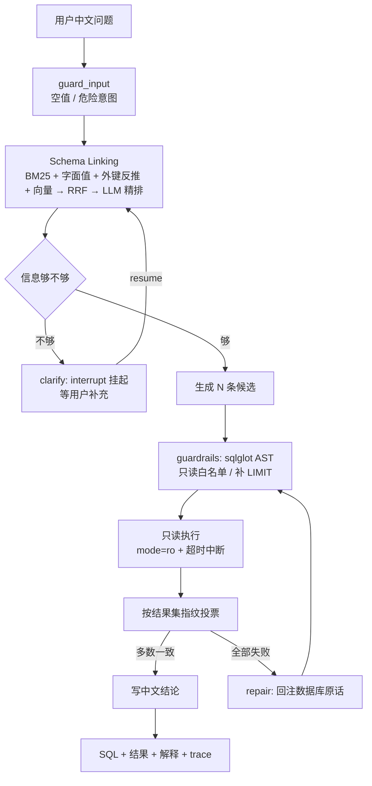

# NL2SQL 智能查询 Agent

用中文问一句业务问题，它自己找表、写 SQL、在只读连接上查完，再把结果讲回中文。

一开始我以为这就是"提示词里塞个 schema 让模型写 SQL"，做下来发现正经的难点都在别处：9 张表它该看哪几张、写出来的 SQL 会不会把数据删了、写错了能不能自己发现、效果好坏怎么衡量。这个仓库就是围绕这几件事攒起来的，前后折腾了挺久，踩的坑都记在最后一节。

支持本地 Ollama，也支持任何 OpenAI 兼容接口（百炼、DeepSeek、OpenAI 都行），换后端改三行配置。

## 怎么跑起来

需要 Python 3.10+，再加一个模型。本地 Ollama 和云端 key 二选一。

```powershell
pip install -r requirements.txt          # 装依赖
ollama pull qwen2.5:7b                   # 本地模型，不想装就跳过
python -m app.db.seed                    # 生成示例库：9 张表、约 1.5 万行
python -m app.cli ask "每个大类里销量最高的商品是哪个？"
```

想用云端模型，把 `.env.example` 复制成 `.env`，改这几行：

```ini
NL2SQL_LLM_BACKEND=openai
NL2SQL_OPENAI_BASE=https://dashscope.aliyuncs.com/compatible-mode/v1
NL2SQL_OPENAI_KEY=sk-xxx
NL2SQL_OPENAI_MODEL=qwen-max
```

服务和界面：

```powershell
python -m app.cli serve --port 8000    # FastAPI，文档在 http://127.0.0.1:8000/docs
python -m app.cli ui                   # Streamlit 界面，http://127.0.0.1:8501
```

测试和评测：

```powershell
python -m pytest tests -q              # 141 个用例，不碰模型，十几秒
python -m eval.run_eval --limit 10     # 先跑 10 题
python -m eval.run_eval                # 全量 60 题，出 markdown 报告
```

> Streamlit 默认往用户目录写配置。那个目录不好写的话，把 `USERPROFILE` / `HOME` 指到别处再启动。

## 跑一题是什么样

```powershell
$ python -m app.cli ask "华东大区2024年每个月的成交额是多少？"

选中表 : orders, region, order_item
SQL    : SELECT STRFTIME('%Y-%m', o.order_date) AS ym, ROUND(SUM(o.total_amount), 2) AS gmv
         FROM orders AS o JOIN region AS r ON o.region_id = r.region_id
         WHERE o.status = 'completed' AND r.region_name = '华东'
           AND o.order_date >= '2024-01-01' AND o.order_date < '2025-01-01'
         GROUP BY ym ORDER BY ym LIMIT 100
结果   : 12 行
投票   : 一致度 1.0  候选 3 条，成功执行 3 条
耗时   : 106177 ms | LLM 3 次 | token 5516
```

这段输出差不多就是它的全部工作：选了哪几张表、写了什么 SQL、查出多少行、三条候选一不一致、花了多久。

## 用 Docker 起服务

镜像里已经把示例库 seed 好了，起来就能查（LLM 走容器外的 Ollama 或云端 API）：

```powershell
# 构建（国内网络：基础镜像和 pip 源都能换）
docker build -t nl2sql-agent:dev `
  --build-arg BASE_IMAGE=docker.m.daocloud.io/library/python:3.10-slim `
  -f Dockerfile .

# 跑起来（把宿主机的 Ollama 暴露给容器）
docker run -d --name nl2sql-api -p 8010:8000 `
  -e NL2SQL_LLM_BACKEND=ollama `
  -e NL2SQL_OLLAMA_BASE=http://host.docker.internal:11434 `
  -e NL2SQL_OLLAMA_NUM_GPU=-1 `
  nl2sql-agent:dev

curl http://127.0.0.1:8010/health
```

实测（Docker Desktop 29.8.2，镜像 924 MB，容器内存约 80 MB）：

| 接口 | 结果 |
|---|---|
| `/health` | 200，`tables=9`，后端 ollama |
| `/query` | 200，返回 SQL + 结论「华东大区已完成订单的总成交额为 4,897,710.21 元」，一致度 1.0，6 次模型调用 / 9970 token / 20.4 秒 |
| `/query/stream` | 200，`Content-Type: text/event-stream`，事件依次 `start → guard_input → link_schema → check_ambiguity` |

Dockerfile 里几个刻意的点：依赖单独一层（改代码不会重装依赖）、构建期就 seed 示例库、`HEALTHCHECK` 打 `/health`、
`data/` 可以只读挂载、两个 `ARG` 让基础镜像和 pip 源都能替换。

**踩坑**：容器内访问国内 pypi 镜像（清华 / 阿里云）会返回 403，反而官方 `pypi.org` 在容器里是通的；
所以默认用官方源，国内构建时只替换基础镜像即可。

### docker compose：API + Ollama 双服务

`docker-compose.yml` 里是两个服务：`api`（本项目镜像）和 `ollama`（推理服务）。

```powershell
# 默认：容器里起一个 Ollama（首次需要 pull 模型）
docker compose up -d
docker compose exec ollama ollama pull qwen2.5:7b

# 更省事：复用宿主机已经 pull 好的模型，并连宿主机 Ollama（跳过 ollama 服务）
$env:OLLAMA_MODELS_DIR='C:/Users/<you>/.ollama/models'
$env:OLLAMA_BASE='http://host.docker.internal:11434'
$env:NL2SQL_MODEL='qwen2.5:7b'
$env:NL2SQL_OLLAMA_NUM_GPU='-1'
docker compose up -d --no-deps api
```

compose 文件里几个刻意的点：`ollama` 默认只在内网 `expose: 11434`（不占宿主机端口，避免和本机已装的
Ollama 抢）、模型目录可用 `OLLAMA_MODELS_DIR` 指向宿主机（省掉几个 G 的重复下载）、
模型/候选数/GPU 开关都能用环境变量覆盖。

实测（Docker Desktop 29.8.2）：

```
api | Up (healthy) | 0.0.0.0:8010->8000/tcp
[health] 表数=9 后端=ollama 模型=qwen2.5:7b
[query]  SQL  : SELECT ROUND(SUM(o.total_amount), 2) AS gmv FROM orders AS o JOIN region AS r ...
         结论 : 华东大区已完成订单的总成交额为4,897,710.21元。
         trace: LLM 4 次 | token 5236 | 18660 ms
[sse]    text/event-stream，事件 start → guard_input → link_schema → check_ambiguity
```

**诚实交代**：`ollama/ollama:latest` 这个镜像在我这边拉不下来（Docker Hub 不通，试的三个国内镜像源
都没有白名单），所以 compose 的双服务是用「api 服务 + 宿主机 Ollama」验证的——
编排本身、环境变量注入、依赖声明、健康检查都验过；`ollama` 服务只做到 `docker compose config` 解析通过。

## 一条问题进来之后



讲讲每一步在干嘛，以及为什么会需要它。

**先看输入。** 空输入直接拒；"你好""谢谢"这类不打模型，回一段引导语就完事（不然问个好要等好几分钟）。危险意图也在这里拦，后面细说。

**接着找表。** 库里 9 张表全塞给模型，它会被无关表带偏，还容易写出多余 JOIN。所以先做一轮召回：表名列名的关键词匹配、问题里出现的字面值（"华东"在 `region.region_name` 里）、顺着外键反推事实表、以及可选的向量召回，四种结果用 RRF 融合，再让模型从候选里挑两三张。只把挑中的表结构拼进 prompt。

这里有个我卡了很久的坑：外键扩展必须**按表**推。值命中的是 region 这张表，得去问"谁引用了 region"，才能找到 orders；只在列上做匹配，永远扩不到事实表。

**然后判断信息够不够。** "最近的销售情况怎么样"这种，缺指标缺时间范围，硬猜就是瞎答，所以反问一句再算。这一步用 LangGraph 的 `interrupt()` 把流程挂起，用户答完从断点继续。

**生成三条 SQL。** 同一个问题采样三条，每条生成完立刻过 sqlglot 的语法树白名单：只允许 SELECT、单语句、不碰系统表、没写 LIMIT 自动补。

**跑起来投票。** 三条分别执行，结果集规范化之后按指纹投票。这里比的是"查出来的东西"而不是 SQL 字符串，因为 `COUNT(*)` 和 `COUNT(order_id)` 写法不同结果一样，比文本会把对的判成错的。

**错了就改。** 三条全挂掉时，把数据库返回的错误原文贴回去，要求最小改动重写，最多两轮。

**最后一句话总结。** 不甩一张表给用户，而是写一句"2024 年各月成交额如下，其中 3 月最高"。

编排有两套实现，共用同一套节点代码：正式跑用 LangGraph（要条件边、多轮记忆、`interrupt`），命令行和评测用不依赖框架的顺序循环（秒级能跑，写测试方便）。

## 另一条路：让模型自己选工具

上面这条是"我规定步骤"。还有一条反过来：只把工具清单丢给模型，它自己决定先看表结构还是直接查数。

```powershell
python -m app.cli ask "一共有多少个客户？" --mode tools   # 调本地工具
python -m app.cli ask "一共有多少个客户？" --mode mcp     # 调 MCP server 的工具
```

本地 7B 在 CPU 上的真实轨迹，三步 20.9 秒：

```
[tools] 本地工具：['list_tables', 'get_schema', 'run_sql']
  ↳ 第1轮 get_schema({"tables": ["customer"]})                # 它自己决定先看表结构
  ↳ 第2轮 run_sql({"sql": "SELECT COUNT(*) FROM customer"})   # 然后自己写 SQL
结论   : 一共有200个客户。
```

两条路的差别很直白：流水线稳、可评测（下面所有数字都是它的），但流程之外的问题走不通；自主调工具灵活，但小模型会乱调。工具模式我还没在 60 题基准上跑过，所以那个准确率不能算它头上。

## 它还记得上一轮问过什么

**会话内**是为了让"那上个月呢"接得上。带 `--session` 跑，默认记最近 4 轮问答：

```powershell
python -m app.cli ask "一共有多少个客户？" --session demo1
python -m app.cli ask "那已取消的订单有多少？" --session demo1
# [记忆] 会话 demo1：已载入 1 轮历史
```

存的是问题和结论（不塞整段 SQL，省 token），拼进生成 Prompt 供指代消解，落在 `data/sessions/<id>.json`。

**跨会话**是为了不用每轮重复交代口径：

```powershell
python -m app.cli memory add "成交额只算已完成订单" --kind metric
python -m app.cli memory list
python -m app.cli memory recall "华东成交额"
python -m app.cli ask "华东这个月成交额多少？" --memory
```

召回用 token 重叠打分（中文按字和二字组），相关度低于阈值的不注入——不然"我记了很多"就变成"prompt 里塞一堆无关的话"。记忆是人能读能删的文本，不是隐向量，`memory forget --id xxx` 就删了。

存储做了可切换。默认落本地文件 + SQLite，不需要任何额外服务；想多进程共享会话就换 Redis：

```powershell
docker run -d --name nl2sql-redis -p 6379:6379 redis:7-alpine
pip install redis
$env:NL2SQL_MEMORY_BACKEND=redis
python scripts/check_redis_memory.py    # 连通性 / 截断 / TTL / 召回 / 计数 / 清理，11 项
```

会话在 Redis 里是 `nl2sql:session:<id>`（LIST + LTRIM + EXPIRE，默认 7 天自动过期），偏好是 `nl2sql:memory:facts`（HASH）+ 一个记命中次数的 HASH。联调脚本 11 项全过的时候，`TTL` 那儿显示 604785 秒，看着还挺有成就感。

> Docker Hub 拉不动的话，用国内镜像：`docker pull docker.m.daocloud.io/library/redis:7-alpine` 再 tag 成 `redis:7-alpine`。

## 也能挂到别的客户端里用（MCP）

`mcp_server.py` 把查询能力包成标准 MCP 工具，Claude Desktop、Cursor 或者自己写的 Agent 都能直接连：

| 工具 | 作用 |
|---|---|
| `list_tables` | 列出 9 张表、行数、一句话说明 |
| `get_schema` | 指定表的结构：列名、类型、外键、抽样值、业务注释 |
| `run_sql` | 执行只读 SELECT，复用同一套护栏 |
| `ask` | 中文提问，走完整流程 |

客户端配置（Cursor 的 `mcp.json` 或 Claude Desktop 的 `claude_desktop_config.json`），路径换成自己的：

```json
{"mcpServers": {"nl2sql": {
  "command": "<python 可执行文件路径>",
  "args": ["<仓库路径>/mcp_server.py"]
}}}
```

反方向也写了：`app/agent/mcp_client.py` 能连任意 MCP server，动态拿到工具清单再交给模型。之所以要单独写，是因为 MCP 的 SDK 是异步的、而 Agent 是同步的——做法是在后台线程跑一个事件循环长期持有会话，同步侧用 `run_coroutine_threadsafe` 转发，这样一次连接服务多轮调用，不用每次重启子进程。

这块的测试比较有意思：让测试 server 提供一个 `whoami` 返回自己的 pid，`close()` 之后断言进程真的死了；还有连续开关三次确认没留僵尸进程。受限环境（不允许建子进程管道）下这些用例会自动 skip。

## 现在的数字

先说环境。本机 RTX 3060 Laptop（6GB），驱动 596.49 + Ollama 0.40.9。早先是驱动 546.30，跟当时的 Ollama CUDA 内核不兼容，一上 GPU 就崩，只能 CPU 跑；升级之后好了，但 6GB 显存装不下 7B 全部层，实际只有 79%~84% 在显存里。

同一份 60 题、同一套代码，换个推理设备：

| 指标 | CPU（旧驱动） | GPU |
|---|---|---|
| 执行准确率（严格 / 宽松） | 61.2% / 85.7% | 63.3% / 93.9% |
| 延迟 p50 | 90.0 s | 19.5 s |
| 全量 60 题 | 96.9 min | 20.5 min |
| 生成速度 | 7.7 tok/s | 26.4 tok/s |

那 2.1 个点的准确率涨幅是期间改提示词的功劳（列纪律、ROUND、排名 tie-break），跟 GPU 没关系——换设备不会改变模型输出质量。

再换个模型（上一版提示词跑的，没重跑）：

| 指标 | 本地 qwen2.5:7b | 百炼 qwen-max |
|---|---|---|
| 执行准确率（严格 / 宽松） | 61.2% / 85.7% | 83.7% / 93.9% |
| 延迟 p50 | 90.0 s | 14.9 s |
| 窗口函数类 | 14% | 71% |

宽松口径是这么来的：复核错题时发现，被判"错"的里面一多半其实是列数不一致——问"信用卡支付有多少笔"，它顺手多返回一列金额；问"有哪些大区"，它只给大区名，而我的标准答案多带了计数。这种人工看都算答对，所以又加了一个允许列数差异的口径。换云端后仍错的 8 题里，6 题是列数差异，真错的 2 题：一题口径分歧（"每个大类的商品数量"它按直属商品算，我的标准答案是含子类汇总），一题是幻觉（问库里没有的"苹果手机"，它没返回空集，而是给了全库汇总）。

按题型看（GPU 那一轮）：简单查询和过滤 100%，聚合 92%，日期 67%，多表 Join 40%，边界 40%，**窗口函数 14%**，Top-N 0%。窗口函数和 Top-N 是明确短板，本质是小模型能力不够——换云端能到 71% 和 50%。

EM（SQL 字符串精确匹配）是 0%。这不是 bug：别名、`ROUND`、JOIN 顺序一变就判错，这个 0 本身就说明文本比对不适用。生成 SQL 的合法率 100%，澄清 6/6，危险请求拦截 5/5，跑完全量评测所有表行数没变。

### 几件没做成的事

**投票没提升准确率。** 60 题里，关掉投票（N=1）和开着（N=3）都是 61.2%，但延迟 48.7 秒变 90 秒、token 31 万变 56 万。原因是这套题大多是确定性单答案，三条候选一致度普遍 1.0，投票没有信息量。所以做成配置项而不是无脑开满，实验记录也留着——真要发挥它，得是语义有歧义、采样敏感的问题。

**自愈也没救回题目。** 这一轮它触发 2 次，两次都没救回来（q056 改了两轮还是挂）。所以"自愈能把错误救回来"在这份数据上没被验证，它目前只保证流程不卡死。要真有用，得把错误分类（列名错 / 语法错 / 表不存在）分别给不同修复提示。

**澄清差点被我自己改坏。** 一开始误澄清率 30.6%（49 道能直接答的题里反问 15 道，连"上海的客户有多少人"都问）。收紧提示词后误澄清降到 0，但全量重跑发现该问的只剩 3/6——抽样复测显示 5/6，低估了退步幅度。最后加了一层规则白名单（`app/clarify_rules.py`）："最近""大客户""情况怎么样""卖得好"这类没有量化标准的说法，正则命中直接反问，不交给模型判断。全量重跑回到 6/6，误澄清还是 0。

这件事给我的教训是：**该用规则的地方别指望模型**。模型在"要不要打扰用户"这类问题上天然偏保守，你让它自由裁量，它就会一路"能兜就兜"。

### 一个意外有用的副产品

投票一致度除了投票，还能当置信度用。按一致度分桶统计真实正确率：

| 一致度 | 本地题数 / 准确率 | 云端题数 / 准确率 |
|---|---|---|
| 1.00（三条一致） | 36 / 72.2% | 52 / 76.9% |
| 0.67（两条一致） | 15 / 26.7% | 6 / 16.7% |
| 三条各不相同 | 9 / 0% | 2 / 0% |

区分度 AUC 0.787（本地）和 0.673（云端）。意思是：只要有候选不一致，基本就答错了，所以拿它在界面上提示"这条可能不准"是靠谱的。但反过来，高置信组里还有 23% 左右答错——模型很自信地答错，这类只能靠提示词和更强的模型去压。

另外还做了个稳定性测试：同一个问题写 5 种说法，看答案变不变。10 组里 8 组完全一致，组内一致率 94%、逐说法 EX 90%。不一致的两组，一个是窗口函数的列选择不稳（多带了 `product_id`、少了 qty），一个是 Top-N 忘了 `ROUND` 导致数值尾巴不同。

## 几个当时的判断

**没用 LangChain 的 `SQLDatabaseChain`。** 它把"取 schema → 生成 → 执行"封成一个黑盒，出错时插不进自己的重试、投票和护栏，中间状态也没法写进 trace。所以只用 LangGraph 做编排，LLM 层自己封装（结构化输出、用量统计、重试降级），其余全是显式代码，出问题能定位到具体节点。

**护栏用 AST，不用正则。** 正则和关键词黑名单两头不讨好：误杀（列名叫 `drop_flag` 就被拦）和漏杀（注释里藏语句、大小写变一变都绕得过去）。sqlglot 解析成语法树之后，才能稳定回答"这是什么语句、碰了哪些表、有没有 LIMIT"。覆盖了多语句注入、DDL/DML、PRAGMA/ATTACH、系统表 `sqlite_master`、危险函数 `load_extension`。

**只读做了两层。** 语法树管 SQL 层，连接层再用 `mode=ro` + `PRAGMA query_only=1` 兜一层。就算护栏被绕过，写操作也会被 SQLite 自己拒掉（测试里验证过，INSERT 直接报 `readonly database`）。

**危险意图在输入层就拒，不等 SQL 层。** 这件事是被一个尴尬的 case 逼出来的：早期只在 SQL 层拦，结果"把订单表删掉"这种中文请求被当成歧义反问了一句"请问是要统计订单数量还是金额？"。现在 `check_question` 里补了中文写意图的正则（删/清空/改成/插入 + 表/数据/订单），命中就直接回"只支持只读查询"，一次模型都不调——实测 5 道危险题里 4 道 0.0 秒返回，剩下一道读系统表的由 AST 护栏拦住。规则写成"动词 + 数据对象"的组合，是为了别把"已取消的订单有多少"判成写操作。

**超时靠 `set_progress_handler`。** SQLite 没有 statement_timeout，线程 kill 和 `conn.interrupt()` 都不够可靠。在 VM 回调里检查 deadline 再抛错，能精确打断一条正在跑的慢查询（0.4 秒阈值实测 0.40 秒断开）。

**超时不等于能随时掐断。** 模型调用本身没法中途打断（HTTP 请求已经在飞了），所以打断的粒度是"阶段之间"。界面上点停止、代码里 `iter_run(cancel_event=...)`，都是在这个粒度上生效。单次提问还有个总预算（`NL2SQL_REQUEST_BUDGET`，默认 120 秒），超了带着已有结果返回并说明原因。

## 目录结构

```
app/
├── config.py          配置集中处，也是消融实验的开关
├── llm.py             Ollama 原生 API + OpenAI 兼容 + Fake（测试用）
├── tracing.py         逐节点耗时/token/成本，JSONL 落盘
├── memory.py          会话记忆 + 长期偏好，本地或 Redis
├── clarify_rules.py   澄清规则白名单（该问的那几类直接问）
├── guardrails.py      sqlglot AST 护栏 + 结果集规范化
├── schema_linker.py   BM25 + 值命中 + 外键扩展 + RRF + 向量 + LLM 重排
├── prompts.py         业务口径、few-shot、自愈、澄清、解释
├── candidates.py      N 候选生成 + 结果指纹 + 投票
├── api.py             FastAPI：/query /query/clarify /query/stream(SSE) /health /schema
├── cli.py             ask / serve / ui / seed / schema / memory
├── db/                示例库生成、表画像、只读执行器
└── agent/             state / nodes / graph / core / tool_loop / mcp_client
mcp_server.py          MCP Server（stdio），4 个工具
eval/                  题库、指标、评测执行器、manifest
tests/                 141 个用例
scripts/               题库构建、GPU 探测、Redis 联调、软指标、稳定性评测
```

## 评测是怎么算的

`eval/questions.jsonl` 是 60 道题，按能力分组：单表、聚合、日期、多表关联、窗口函数、Top-N、HAVING、边界、歧义、注入安全。每题都带标准 SQL，而且逐条执行核对过结果——标准答案本身也错过几条，改的时候才发现。

主指标是执行准确率：跑标准 SQL 和模型 SQL，结果集规范化后比较是否等价。同时报 EM、澄清准召、拦截率、自愈触发率、延迟分位、token 和调用次数。评测跑完会再确认一遍所有表行数没变。

想复现某个模块的作用，直接关掉它再跑：

```powershell
$env:NL2SQL_N_CANDIDATES=1      ; python -m eval.run_eval --tag ablate-vote-off
$env:NL2SQL_MAX_REPAIR_ROUNDS=0 ; python -m eval.run_eval --tag ablate-repair-off
python -m eval.run_eval --no-rerank --tag ablate-rerank-off
```

每次评测会落一份 manifest，记录 git commit 和分支、有没有未提交改动、后端与模型、候选数、温度，以及 `prompts.py` / `schema_linker.py` / `guardrails.py` / 题库的哈希。报告末尾会附一行：

```
复现信息：commit `97130cc`@main｜模型 `qwen-max`｜backend `openai`｜N=3｜
         strict=True｜prompts.py#`a0b85361...`｜题库#`805047dd...`
```

做这个是因为吃过亏：改完提示词之后，"之前那个 83.7% 到底对应哪一版"说不清了。现在提示词哈希一变，就说明不能跟老数字横向比。

## 现在的限制

- **模型就是天花板**：CPU 上跑 7B，复杂窗口函数和多级嵌套聚合容易错。这一点换模型能立刻看到效果，框架层面没什么好办法。
- **歧义判断仍有抖动的可能**：规则覆盖了常见的几类，但没覆盖到的边界样本（比如"重要客户"没有明确定义）还是靠模型，偶尔会漏。
- **向量召回默认关**：上面那些准确率是不开向量召回的数字。打开后召回更强（同义词提问 8/10 → 10/10），但指标得重跑才能横向比。
- **只支持 SQLite**：接 PostgreSQL/MySQL 要改 executor，护栏的 sqlglot dialect 也得换。
- **评测集是自建的 60 题**，跟 Spider/BIRD 这类公开集不通用，想跟别人横向比得另接数据集。
- **没上线过**：没有并发压测、没有鉴权和多租户，Docker 文件写了但没实际构建跑过。

## 踩过的坑

1. **GPU 推理直接崩**，`CUDA error: device kernel image is invalid`。折腾了很久才确认是驱动 546.30 和当时 Ollama 的 CUDA 内核不匹配——qwen 和 bge-m3 都会让 llama-server 挂。当时的处理是默认 `num_gpu=0` 走 CPU，并在后端里做"GPU 失败自动降级"。后来升级到驱动 596.49 + Ollama 0.40.9，实测能用了：7B 生成 7.7 → 26.4 tok/s，端到端 p50 从 90 秒降到 19.5 秒。`scripts/probe_gpu.py` 可以随时复测这套结论。

2. **临时脚本遮蔽标准库**。项目里放过一个 `inspect.py`，结果 `import inspect` 被它顶掉，pandas 之类的导入全崩，报的还是 `FileNotFoundError`，查了很久。临时文件命名要避开标准库。

3. **trace 跨题累积**。评测时 tracer 必须逐题 reset，否则 token 和调用次数是累计值，指标全废——第 60 题的数字看着像第 1 题的 60 倍。

4. **PowerShell 脚本编码**。`scripts/*.ps1` 里的中文注释要存成 UTF-8 带 BOM，否则 Windows PowerShell 5.1 按 GBK 读会报一堆假语法错误；另外执行策略会拦未签名脚本，用 `powershell -ExecutionPolicy Bypass -File` 调用。

5. **多轮工具调用的格式差异**。历史消息里要带回 `tool_calls`，OpenAI 协议要求 `arguments` 是 JSON 字符串，Ollama 原生 API 要求是对象。发错了 Ollama 直接 400，报的是 `Value looks like object, but can't find closing '}' symbol`——我一开始还以为是模型把 JSON 写坏了，查了半天才发现是协议格式问题。后来在 Ollama 后端入口做了一层消息归一化。

6. **小模型偶尔输出坏 JSON**。调工具时 `arguments` 写残，Ollama 解析失败返回 400。这类错误要当可重试处理，一次失败就放弃的话工具循环基本没法用。

7. **去 Docker Hub 拉镜像超时**。`registry-1.docker.io:443` 连不上，换国内镜像源：

   ```powershell
   docker pull docker.m.daocloud.io/library/redis:7-alpine
   docker tag  docker.m.daocloud.io/library/redis:7-alpine redis:7-alpine
   ```

## 许可

暂未指定许可证，商业用途请先联系作者。
