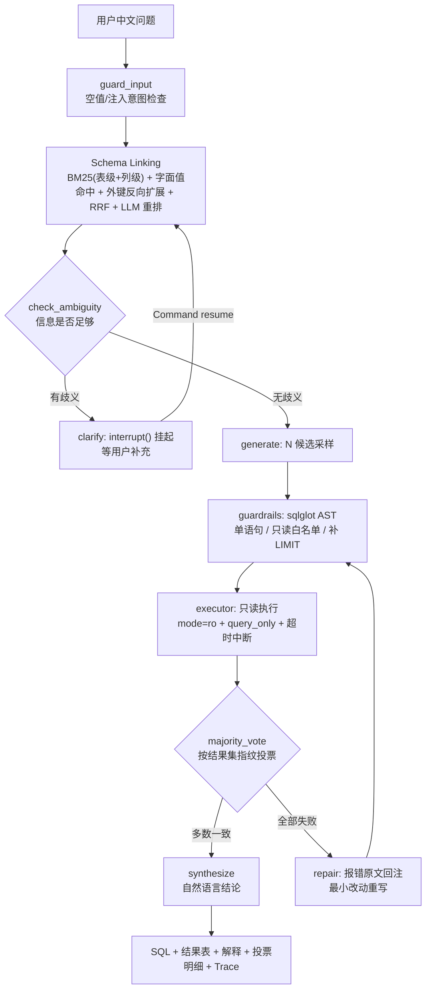

# NL2SQL 智能查询 Agent

把一个中文问题变成可执行的 SQL，在只读连接上跑完，再把结果讲回中文。

看起来像是"让大模型写 SQL"这么简单，实际做起来难点都在别处：库里 9 张表它该看哪几张、写完的 SQL 会不会把数据删了、模型写错了能不能自己发现、效果到底好不好怎么衡量。这个项目就是围绕这几个问题搭起来的一套东西。

- 表结构不整库塞给模型，先检索出相关的那两三张表
- 写 SQL 之前过一遍语法树白名单，只读连接再兜一层
- 一次生成三条候选，按查询结果投票，而不是比 SQL 文本
- 执行报错就把数据库的原话贴回去让它改，最多两轮
- 自带 60 道题的评测集和指标报表，好坏有数字

支持本地 Ollama 或任何 OpenAI 兼容接口（百炼、DeepSeek、OpenAI 都行），换后端只改三行配置。

## 快速开始

需要 Python 3.10+ 和一个模型（本地 Ollama 或云端 key 任选其一）。

```powershell
# 1. 装依赖
pip install -r requirements.txt

# 2. 本地模型（不想装就跳过，改用 .env 里的云端配置）
ollama pull qwen2.5:7b

# 3. 生成示例库：9 张表、约 1.5 万行，固定随机种子，可复现
python -m app.db.seed

# 4. 问一句
python -m app.cli ask "每个大类里销量最高的商品是哪个？"
```

用云端模型的话，把 `.env.example` 复制成 `.env`，改这几行：

```ini
NL2SQL_LLM_BACKEND=openai
NL2SQL_OPENAI_BASE=https://dashscope.aliyuncs.com/compatible-mode/v1
NL2SQL_OPENAI_KEY=sk-xxx
NL2SQL_OPENAI_MODEL=qwen-max
```

服务和界面：

```powershell
python -m app.cli serve --port 8000    # FastAPI，接口文档在 http://127.0.0.1:8000/docs
python -m app.cli ui                   # Streamlit 聊天界面，http://127.0.0.1:8501
```

跑测试和评测：

```powershell
python -m pytest tests -q              # 98 个用例，不依赖模型，十几秒跑完
python -m eval.run_eval --limit 10     # 先跑 10 题试水
python -m eval.run_eval                # 全量 60 题，出 markdown 报告
```

> Streamlit 默认会把配置写到用户目录。如果那个目录不好写，把 `USERPROFILE` / `HOME` 指到别处再启动即可。

## 跑起来是什么样

```powershell
$ python -m app.cli ask "华东大区2024年每个月的成交额是多少？"

选中表 : orders, region, order_item
SQL    : SELECT STRFTIME('%Y-%m', o.order_date) AS ym, ROUND(SUM(o.total_amount), 2) AS gmv
         FROM orders AS o JOIN region AS r ON o.region_id = r.region_id
         WHERE o.status = 'completed' AND r.region_name = '华东'
           AND o.order_date >= '2024-01-01' AND o.order_date < '2025-01-01'
         GROUP BY ym ORDER BY ym LIMIT 100
结果   : 12 行
投票   : 一致度 1.0  候选 3 条，成功执行 3 条
耗时   : 106177 ms | LLM 3 次 | token 5516
```

这段输出基本就是它的全部工作过程：选了哪几张表、写出了什么 SQL、查出来多少行、三条候选是否一致、花了多少时间。

## 它是怎么工作的



每一步在干什么：

1. **guard_input**：拦空输入、明显的注入意图；打招呼这类非数据问题直接回一句，不打模型。
2. **Schema Linking**：把库表画像当成检索语料，四路召回（表列 BM25、问题里的字面值、顺着外键反推事实表、可选的向量召回），RRF 融合之后让模型在候选里精挑。最后只把命中的表结构拼进 prompt。
3. **check_ambiguity**：判断缺不缺关键信息（时间范围、指标口径）。缺就反问用户，`interrupt()` 把整个流程挂起，收到回答后从断点继续。
4. **generate**：同一个问题采样三条 SQL，每条生成完立刻过护栏。
5. **执行与投票**：三条 SQL 分别执行，结果集规范化后按指纹投票。投票比的是"查出来的东西"，不是 SQL 字符串。
6. **repair**：三条都跑挂了，就把数据库返回的错误原文回注，要求最小改动重写，最多两轮。
7. **synthesize**：把结果集写成一句中文结论，而不是甩一张表。

有两套编排实现，共用同一套节点代码：

| 实现 | 入口 | 用在哪 |
|---|---|---|
| LangGraph StateGraph | `GraphAgent`（`app/agent/graph.py`） | 正式跑：条件边、Checkpointer 多轮记忆、`interrupt()` 澄清 |
| 顺序循环 | `NL2SQLAgent.run()`（`app/agent/core.py`） | CLI、评测、单元测试：不依赖框架，秒级可测 |

## 两种跑法

除了上面这条固定流程，还做了另一条路：不规定步骤，只把工具交给模型，让它自己决定调哪个、调几次。

```powershell
python -m app.cli ask "一共有多少个客户？" --mode tools   # 模型自主调本地工具
python -m app.cli ask "一共有多少个客户？" --mode mcp     # 模型自主调 MCP server 的工具
```

实测轨迹（本地 qwen2.5:7b，CPU，3 步 20.9 秒）：

```
[tools] 本地工具：['list_tables', 'get_schema', 'run_sql']
  ↳ 第1轮 get_schema({"tables": ["customer"]})                # 先看表结构
  ↳ 第2轮 run_sql({"sql": "SELECT COUNT(*) FROM customer"})   # 自己写 SQL
结论   : 一共有200个客户。
```

两条路的取舍：

| | 流水线（默认） | 工具自主 |
|---|---|---|
| 谁定流程 | 代码里写死的顺序 | 模型自己决定 |
| 好处 | 稳、可评测（下面那些数字都是它的） | 灵活，能走没预设过的路径 |
| 代价 | 流程之外的问题走不通 | 依赖模型能力，小模型容易乱调 |

工具自主模式还没有在 60 题基准上跑过，所以下面的准确率不能算在它头上。

## 记忆：会话内多轮 + 跨会话偏好

分两层，解决的问题不一样。

**短期（会话内）** —— 让「那上个月呢」这类追问接得上。带 `--session` 跑，默认记最近 4 轮：

```powershell
python -m app.cli ask "一共有多少个客户？" --session demo1
python -m app.cli ask "那已取消的订单有多少？" --session demo1
# [记忆] 会话 demo1：已载入 1 轮历史
```

存的是最近几轮的问题与结论（不塞整段 SQL，省 token），拼进生成 Prompt 供指代消解；
落在 `data/sessions/<id>.json`，随时可删。

**长期（跨会话）** —— 记住口径和偏好，不用每轮重复交代：

```powershell
python -m app.cli memory add "成交额只算已完成订单" --kind metric
python -m app.cli memory list
python -m app.cli memory recall "华东成交额"      # 按关键词相关度召回
python -m app.cli ask "华东这个月成交额多少？" --memory
```

召回用 token 重叠打分（中文按字 + 二字组），相关度低于阈值的不注入，避免把无关偏好塞进上下文。
记忆是**人能读能删的文本**，不是隐向量；SQLite 一张表，`memory forget --id xxx` 就能删。

两个刻意的限制：短期只留最近 N 轮，防止上下文越来越长；长期只注入 top-3 且要过阈值，
防止"我记了很多"变成"prompt 里塞一堆无关的话"。

### 存哪儿：本地文件 / SQLite，还是 Redis

默认是本地（会话写 `data/sessions/*.json`、偏好写 `data/memory.db`），不需要任何额外服务。
换成 Redis 只要一个环境变量：

```powershell
# 1) 起一个 Redis（任选其一）
docker run -d --name nl2sql-redis -p 6379:6379 redis:7-alpine
#   或 Windows 上用 Memurai / Redis for Windows（端口 6379）

# 2) 装客户端
pip install redis

# 3) 切后端
$env:NL2SQL_MEMORY_BACKEND=redis
$env:NL2SQL_REDIS_URL=redis://127.0.0.1:6379/0

# 4) 验证（连通性 / 会话截断 / TTL / 召回 / 命中计数 / 清理，逐条打印）
python scripts/check_redis_memory.py
```

点 `--memory-backend redis` 也能临时切，不用改环境变量：

```powershell
python -m app.cli ask "华东成交额多少？" --session s1 --memory --memory-backend redis
python -m app.cli memory list --memory-backend redis
```

两种后端的取舍：

| | 本地（默认） | Redis |
|---|---|---|
| 需要额外服务 | 不需要 | 要起 Redis |
| 多实例共享会话 | 不行（各自读本地文件） | 可以 |
| 过期清理 | 手工删文件 | `EXPIRE` 自动过期（默认 7 天） |
| 键设计 | — | 会话 `nl2sql:session:<id>`（LIST + TTL）；偏好 `nl2sql:memory:facts`（HASH）+ `:hits` 计数 HASH |
| 适合 | 单机自用、演示 | 多进程/多实例、需要 TTL 与共享 |

Redis 实现同样遵守"可读可删"：`memory list` 看到的是文本，`memory forget --id xxx` 直接 `HDEL`。
没有引入 RediSearch 之类的向量检索 —— 几十条偏好用不到，真要做语义召回再说。

## 可观测：逐节点 trace

每个节点开一个 span，记录耗时、token、LLM 调用次数与错误，落成 JSONL：

```
trace c5e0d6c154ac  110431 ms
  link_schema             22911.3 ms  llm=1  tok=539/31
  check_ambiguity         45139.4 ms  llm=1  tok=2171/18
  generate                39630.6 ms  llm=3  tok=6783/192
  execute_candidates         15.2 ms  llm=0  tok=0/0
  synthesize               2722.9 ms  llm=1  tok=95/8
```

时间花在哪一眼就能看出来：本地 CPU 上这一问 110 秒，判歧义和生成占掉 85 秒。

默认只记计数，**不记模型的原始请求和响应**（否则文件会很大）。排查坏样本时开 `NL2SQL_TRACE_LLM=1`，
每个 span 会带上模型收到的 messages 和返回内容（各截断到 2k 字符），这样任何一次翻车都能完整回放。

## MCP：既能当 Server，也能当 Client

`mcp_server.py` 把查询能力包成标准 MCP 工具，任何支持 MCP 的客户端（Claude Desktop、Cursor、自己写的 Agent）都能直接调：

| 工具 | 作用 |
|---|---|
| `list_tables` | 列出 9 张表、行数、一句话说明 |
| `get_schema` | 指定表的结构：列名、类型、外键、抽样值、业务注释 |
| `run_sql` | 执行只读 SELECT，复用同一套护栏和超时 |
| `ask` | 中文提问，走完整的 Agent 流程 |

客户端配置（Cursor 的 `mcp.json` 或 Claude Desktop 的 `claude_desktop_config.json`），把路径换成你自己的：

```json
{
  "mcpServers": {
    "nl2sql": {
      "command": "<python 可执行文件路径>",
      "args": ["<仓库路径>/mcp_server.py"]
    }
  }
}
```

反过来也做了：`app/agent/mcp_client.py` 可以连上任意 MCP server，动态拿到它的工具清单，再交给模型调用。之所以要单独写这个，是因为 MCP 的 SDK 是异步的，而 Agent 是同步的——实现方式是在后台线程跑一个事件循环、长期持有一个会话，同步侧用 `run_coroutine_threadsafe` 把调用转发过去，这样一次连接能服务多轮调用，不用每次重启子进程。

这几块有测试兜着：

```powershell
python scripts/test_mcp_tools_inprocess.py   # 工具逻辑与护栏，15 项
python scripts/test_mcp_server.py            # 真实 stdio：握手 → tools/list → tools/call
python -m pytest tests/test_mcp_client.py -v # 动态发现 / 调用转发 / 关闭不泄漏
```

其中"关闭不泄漏"是让测试 server 返回自己的 pid，断言 `close()` 之后进程真的退出；还有一条连续开关三次、确认没有僵尸进程的用例。受限环境（不允许建子进程管道）下这些用例会自动 skip。

## 实测数据

先交代环境：全部在本机跑（RTX 3060 Laptop，但驱动 546.30 和当前 Ollama 的 CUDA 内核不兼容，所以走 **CPU 推理**，qwen2.5:7b 约 14.6 tok/s）。所以下表的本地延迟是"纯 CPU 小模型"的水平，不是这套代码的性能上限。

### 本地 7B vs 云端 qwen-max

同一套代码、同一份 60 题，只换 LLM 后端：

| 指标 | 本地 qwen2.5:7b（CPU） | 百炼 qwen-max |
|---|---|---|
| 执行准确率（严格口径） | 61.2% | **83.7%** |
| 执行准确率（列数宽松口径） | 85.7% | **93.9%** |
| 延迟 p50 / mean | 90.0 / 96.9 s | **14.9 / 15.5 s** |
| 全量 60 题耗时 | 96.9 min | 15.5 min |
| 窗口函数类 | 14% | **71%** |
| 日期 / 多表 Join / Top-N | 67% / 40% / 0% | 100% / 67% / 50% |
| 60 题 token | 56 万 | 56.3 万（按占位价约 0.6 元） |
| 由错转对 / 由对转错 | — | 11 题 / 0 题 |

严格口径和宽松口径的差别说一下：

- **严格**：结果集行序无关，但列数和列序要一致，数值带 1e-4 容差；
- **宽松**：允许模型多给或少给列，只要公共列的值对得上。

加宽松口径是因为复核错题时发现，"错"里有一大半其实是**列数不一致**：问"信用卡支付有多少笔"，它顺手多返回一列金额；问"有哪些大区"，它只给大区名，而我的标准答案多带了计数。这类差异人工看都算答对。换云端之后仍错的 8 题里，6 题是列数差异，2 题是真错——一题口径分歧（"每个大类的商品数量"，它按大类直属商品算，我的标准答案按含子类汇总），一题是幻觉（问库里没有的"苹果手机"，它没返回空集，而是给了全库汇总）。

### 分类表现（本地 7B）

| 类型 | 题数 | EX | 类型 | 题数 | EX |
|---|---|---|---|---|---|
| 简单查询 | 9 | 100% | 多表 Join | 15 | 40% |
| 聚合 | 12 | 83% | 边界 | 5 | 40% |
| 日期 | 9 | 67% | 窗口函数 | 7 | 14% |
| 过滤 | 1 | 100% | Top-N | 4 | 0% |
| | | | HAVING | 1 | 0% |

其他指标：EM（SQL 字符串精确匹配）是 0%，因为别名、`ROUND`、JOIN 顺序一变就判错——这本身就说明文本比对不适用；生成 SQL 的合法率 98.3%（60 题里 1 题三条候选全部执行失败）；澄清率 6/6，危险请求拦截 5/5；跑完全量评测后所有表行数不变。

自愈这块要单独说一句：**这轮评测里它触发了 2 次，两次都没把题救回来**（q056 改了两轮仍失败）。所以「自愈能把错误救回来」在这份数据上并没有被验证，它目前只是保证了流程不会卡死。要真正起作用，得把错误类型分类（列名错 / 语法错 / 表不存在）再分别给不同的修复提示，这也是后面想改的地方。

### 两个没达到预期的地方

**自一致性投票没有提升准确率。** 同一套 60 题，关掉投票（N=1）和开着（N=3）准确率都是 61.2%，但延迟从 48.7 秒涨到 90 秒、token 从 31 万涨到 56 万。原因是这套题大多是确定性单答案查询，三条候选一致度普遍是 1.0，投票没有信息量。所以我把它做成了配置项（`NL2SQL_N_CANDIDATES`），默认 3 而不是无脑开满，这个实验记录也留着。真要发挥它的作用，得是语义有歧义、采样敏感的问题。

**歧义判断一开始太激进。** 回算评测数据发现，49 道本可以直接回答的题里有 15 道被反问，误澄清率 30.6%（连"上海的客户有多少人"都问）。收紧提示词之后：

| 指标 | 收紧前 | 收紧后 |
|---|---|---|
| 误澄清率（15 道可直答题） | 30.6% | 0% |
| 该澄清召回（6 道歧义题） | 6/6 | 5/6 |

代价是漏掉了一个口径类歧义（"我们的大客户都有哪些"没有量化标准）。这是典型的准召权衡。继续调提示词的收益不大，更实际的做法是对"大客户/活跃/异常"这类词做术语白名单强制澄清，以及把澄清改成建议式（先给一版答案，再问要不要调整），而不是硬拦用户。

### 向量召回的效果

同义词、口语类问题 10 题，两边都关掉 LLM 重排，只比召回路：

| 召回路 | 回答所需的表全在 top-6 内 |
|---|---|
| BM25 + 字面值命中 + 外键扩展 | 8/10 |
| 加上 bge-m3 向量召回 | **10/10** |

补上的两题正好是字面完全不重叠的：「**售后赔付**金额合计多少」（库里叫退款/refund）和「**哪类东西**最贵」（口语，库里叫类目/商品）。bge-m3 是 1024 维的中文 embedding，`ollama pull bge-m3` 就有，配置一行 `NL2SQL_EMBED_MODEL=bge-m3` 启用，留空则关闭。

工程上有个必须注意的点：embedding 调用也要带 `options.num_gpu=0`，否则同样会触发上面那个 CUDA 问题。向量按"模型+文本"哈希落磁盘缓存，重复调用 0.3 ms。

### 软指标：它知不知道自己可能错

硬指标只说"平均 83.7%"，但用户真正关心的是"这一条答案能不能信"。投票一致度正好可以当置信度用，于是按一致度分桶统计真实正确率（`scripts/soft_metrics.py`）：

| 一致度档位 | 本地 7B 题数 / 准确率 | 云端题数 / 准确率 |
|---|---|---|
| 1.00（三条候选完全一致） | 36 题 / **72.2%** | 52 题 / **76.9%** |
| 0.67（两条一致） | 15 题 / **26.7%** | 6 题 / **16.7%** |
| < 0.67（三条各不相同） | 9 题 / **0%** | 2 题 / **0%** |
| 区分度 AUC | **0.787** | 0.673 |

两件事值得记下来：

- **一致度确实是个有效信号**：只要有候选不一致，基本就答错了（0.67 档只有一两成对，三条全不同则全错）。所以拿它在界面上提示"这条结果可能不准"是靠谱的。
- 但反过来，**高置信组里仍有 23%~28% 答错**，这就是最危险的一类：模型很自信但答错。这部分只能靠 Prompt 约束和更强的模型去压，没什么取巧办法。

这也修正了上面"投票收益为 0"的结论：投票确实不提升准确率，但它产出的置信度信号是有用的——两件事不冲突。

另外两个顺带能量化的质量项：**结论可读性**（60 题里 59 题结论带关键数字、长度都在 10~120 字，规则判定，不引模型）；**失败可定位性**（30 道本地错题里 29 道留了生成 SQL，能直接追溯错在哪，100% 可定位）。

> 注：上面这份评测数据是在收紧澄清提示词**之前**跑的（所以那轮触发了 26 次澄清）。收紧后重测，误澄清 0/15、歧义召回 5/6，详见下面「两个没达到预期的地方」。

## 几个设计选择

**没直接用 LangChain 的 `SQLDatabaseChain`。** 它把"取 schema → 生成 → 执行"封成一个黑盒，出错时插不进自己的重试、投票和护栏，中间状态也没法写进 trace。所以只用了 LangGraph 做编排，LLM 层自己封装（结构化输出 + 用量统计 + 重试降级），其余都是显式代码，出问题能定位到具体节点。

**Schema Linking 做了四路召回。** 单靠 BM25 会漏掉"字面值在维表、事实表在别处"的情况：问"华东大区的成交额"，"华东"只出现在 `region.region_name`，真正要查的是 `orders`。所以要加字面值命中和表级外键反向扩展。这里有个坑——外键扩展必须**按表**推：值命中的是 region 这张表，再去查谁引用了 region，才能找到 orders；只在列上找永远扩不过去。

**投票比结果集而不是 SQL 文本。** `COUNT(*)` 和 `COUNT(order_id)` 写法不同结果相同，比文本会把对的判成错的。指纹做了三重规范化：行内单元格排序（列序无关）、行间排序（行序无关）、浮点统一 4 位小数、NULL 统一标记。平票时按执行耗时兜底。

**自愈只回注三样东西。** 失败的 SQL、数据库返回的原始错误、相关的表结构，prompt 里明确要求"做最小必要修改，不要引入新表新列，保持原口径"。轮数有上限，每轮都记进 trace，所以事后能回答"这条 SQL 修了几次、每次错在哪"。

**护栏必须用 AST，不能靠关键词。** 正则和黑名单既有误杀（列名叫 `drop_flag` 就被拦）又有漏杀（注释里藏语句、大小写变一变）。sqlglot 解析成语法树之后，才能稳定回答"这是什么语句、碰了哪些表、有没有 LIMIT"。覆盖了多语句注入、DDL/DML、PRAGMA/ATTACH、系统表 `sqlite_master`、危险函数 `load_extension`。

**只读是两层。** 语法树管 SQL 层，连接层再用 `mode=ro` + `PRAGMA query_only=1` 兜一层。就算护栏漏了，写操作也会被 SQLite 自己拒绝（测试里验证过：INSERT 直接报 `readonly database`）。

**超时用 `set_progress_handler`。** SQLite 没有 statement_timeout，线程 kill 和 `conn.interrupt()` 都不够可靠；在 VM 回调里检查 deadline 再抛错，能精确打断一条正在跑的慢查询（0.4 秒阈值实测 0.40 秒断开）。

## 目录结构

```
nl2sql-agent/
├── app/
│   ├── config.py           环境变量/.env 集中配置（也是消融实验开关）
│   ├── llm.py              后端：Ollama 原生 API + OpenAI 兼容 + Fake（测试用）
│   ├── tracing.py          逐节点耗时/token/成本，JSONL 落盘（可选记录模型原始请求）
│   ├── memory.py           短期会话记忆（多轮）+ 长期偏好记忆（SQLite + 关键词召回）
│   ├── guardrails.py       sqlglot AST 只读护栏 + 结果集规范化
│   ├── schema_linker.py    BM25 + 值命中 + 外键扩展 + RRF + 可选向量 + LLM 重排
│   ├── prompts.py          Prompt 体系（业务口径、few-shot、自愈、澄清、解释）
│   ├── candidates.py       N 候选生成 + 结果指纹 + 投票 + tie-break
│   ├── api.py              FastAPI：/query /query/clarify /query/stream(SSE) /health /schema
│   ├── cli.py              命令行：ask / serve / ui / seed / schema
│   ├── db/{seed,schema,executor}.py   示例库生成 / 表画像 / 只读执行器
│   └── agent/{state,nodes,graph,core}.py       状态 / 节点 / StateGraph / 不依赖框架的核心
│       agent/tool_loop.py                      工具调用循环
│       agent/mcp_client.py                     MCP 客户端
├── mcp_server.py           MCP Server（stdio），把查询能力暴露成 4 个工具
├── eval/{questions.jsonl, metrics.py, run_eval.py, manifest.py}   题库 + 指标 + 评测执行器 + 复现清单
├── tests/                  98 个测试用例
├── ui/streamlit_app.py     聊天界面
├── scripts/                题库构建、各阶段验证脚本
├── Dockerfile / docker-compose.yml
└── docs/PROGRESS.md        开发过程与踩坑记录
```

## 评测是怎么算的

`eval/questions.jsonl` 是 60 道题，按能力分组：单表、聚合、日期、多表关联、窗口函数、Top-N、HAVING、边界、歧义、注入安全。每题都带标准 SQL，且逐条执行核对过结果。

主指标是**执行准确率**：跑标准 SQL 和模型 SQL，结果集规范化后比较是否等价。同时报 EM、澄清准召、危险请求拦截率、自愈触发率、延迟 p50/p95、token 和调用次数。评测结束后会再确认一遍所有表行数没变，作为全程只读的证据。

想复现某个模块的作用：

```powershell
$env:NL2SQL_N_CANDIDATES=1      ; python -m eval.run_eval --tag ablate-vote-off
$env:NL2SQL_MAX_REPAIR_ROUNDS=0 ; python -m eval.run_eval --tag ablate-repair-off
python -m eval.run_eval --no-rerank --tag ablate-rerank-off
```

**每次评测都会落一份 manifest**（`eval/manifest.py`），把"现场"记下来：git commit 与分支、
是否有未提交改动、后端与模型、候选数、温度、几个关键文件的指纹（`prompts.py` / `schema_linker.py` /
`guardrails.py` / 题库）。报告末尾会附一行：

```
复现信息：commit `97130cc`@main｜模型 `qwen-max`｜backend `openai`｜N=3｜
         strict=True｜prompts.py#`a0b8529983615b77`｜题库#`805047ddc363b1c1`
```

起因是改完提示词之后，"之前那个数字到底对应哪一版"说不清了 —— 有了指纹就能直接比对：
提示词文件哈希一变，说明数字不能和老版本横向比。

## 响应速度

本地 CPU 上一次问答要调 6 次模型（召回 1 次、歧义判断 1 次、3 条候选、结果解释 1 次），这也是为什么最初"问一句要等好几分钟"。做了三件事：

- **寒暄快速通道**：规则识别"你好/谢谢/你能做什么"，直接回引导语不打模型，实测 5.8 ms；
- **单次提问总预算**（`NL2SQL_REQUEST_BUDGET`，默认 120 秒）：每个阶段开始前看剩余预算，超了带着已有结果返回并说明原因；
- **收紧超时与重试**：单次调用 300 秒 × 3 次重试（最坏 15 分钟）改成 120 秒 × 1 次。

进程内的打断：`agent.iter_run(question, cancel_event=threading.Event(), budget_s=60)`，置位 event 就在阶段之间退出；界面上的"停止"按钮也是这个机制。

有一个边界要说清楚：**模型调用本身没法中途掐断**（HTTP 请求已经在进行中），所以打断的颗粒度是"阶段之间"，不是"随时"。总预算目前作用在顺序引擎上（界面、SSE、评测），LangGraph 引擎靠快速通道加单次调用超时兜着。

## 示例库

9 张表、3000 订单、9005 明细、154 退款，两级类目加维表事实表结构。刻意埋了坑：空的 `city`、下架商品、取消订单、部分退款、没有上市日期的商品、跨 2024–2025 年的数据。

业务口径（成交额只算 `completed`、销售额是否含折扣、客单价怎么算）写在 `app/prompts.py` 的业务规则里，目的是同一句话不管哪个模型算，口径都一样。

## 已知限制

- **模型是天花板**：CPU 上跑 7B，复杂窗口函数和多级嵌套聚合容易错。换大模型或云端会明显提升（配置项已经就绪）。
- **歧义判断依赖模型自评**，边界样本（比如"大客户"但没有量化标准）会抖。
- **向量召回默认关**：上面 61.2% 是不开向量召回的数字；打开后召回更强，但指标要重跑才能横向比较。
- **只支持 SQLite**：接 PostgreSQL/MySQL 要改 executor，护栏的 sqlglot dialect 也得换。
- **评测集是自建的 60 题**，和 Spider/BIRD 这类公开集不通用，想横向对比得另接数据集。
- **没做过生产部署**：没有并发压测、没有鉴权和多租户。Docker 文件写了但没实际构建跑过。

## 踩过的坑

1. **GPU 推理直接崩**：`CUDA error: device kernel image is invalid`，原因是驱动 546.30 和 Ollama 0.40.3 的 CUDA 内核不匹配。代码默认 `num_gpu=0` 走 CPU，并在后端里做"GPU 失败自动降级"；升级驱动后设 `NL2SQL_OLLAMA_NUM_GPU=-1` 就能用 GPU。
2. **临时脚本遮蔽标准库**：项目里放过一个 `inspect.py`，结果 `import inspect` 被它顶掉，pandas 之类的导入全崩。临时文件命名要避开标准库。
3. **trace 跨题累积**：评测时 tracer 必须逐题 reset，否则 token 和调用次数是累计值，指标全废。
4. **PowerShell 脚本编码**：`scripts/*.ps1` 里的中文注释要存成 UTF-8 带 BOM，否则 Windows PowerShell 5.1 按 GBK 读会报一堆假语法错误；执行策略会拦未签名脚本，用 `powershell -ExecutionPolicy Bypass -File` 调用。
5. **多轮工具调用的格式差异**：历史消息里要带回 `tool_calls`，OpenAI 协议要求 `arguments` 是 JSON 字符串，Ollama 原生 API 要求是对象。发错了 Ollama 直接 400（`Value looks like object, but can't find closing '}' symbol`）。解决办法是在 Ollama 后端入口做一层消息归一化，上层循环保持协议中立。
6. **模型偶尔输出坏 JSON**：小模型调工具时会把 `arguments` 写残，Ollama 解析失败返回 400。这类错误要当可重试处理，不能一次失败就放弃。

## 许可

暂未指定许可证。如果要用于商业场景，请先联系作者。
